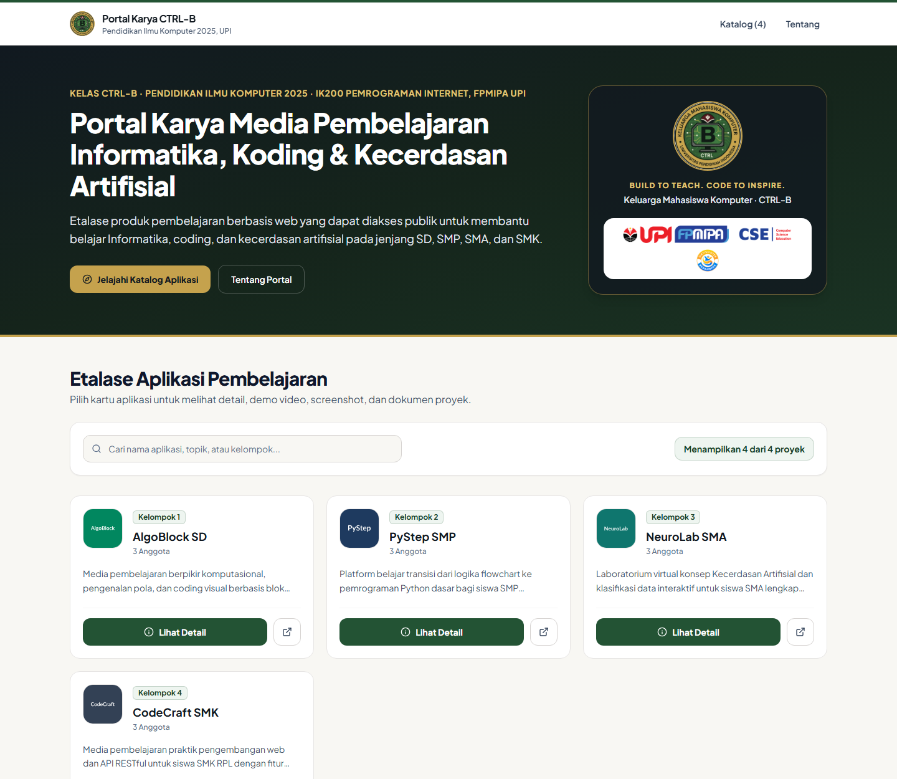

# Portal Karya CTRL-B | IK200 Pemrograman Internet

Portal katalog resmi kelas **CTRL-B** (Angkatan **Pendidikan Ilmu Komputer 2025**, FPMIPA, Universitas Pendidikan Indonesia) untuk memamerkan proyek Tugas Besar Pengganti UAS mata kuliah **IK200 Pemrograman Internet** dengan tema **"Media Pembelajaran Informatika, Koding & Kecerdasan Artifisial"**.

Website ini dirancang menyerupai etalase aplikasi agar dosen, mahasiswa, guru, dan publik dapat menelusuri setiap karya kelompok beserta seluruh artefak wajibnya (tautan website aktif, repository GitHub, galeri screenshot + lightbox, deskripsi dan konteks pembelajaran, video demo aplikasi, serta dokumen PDF Slide Presentasi, SKPL, dan Panduan Pengguna) yang dikelola secara terpusat melalui `src/data/projects.json`.

## Teknologi yang Digunakan

- **React 19** (Functional Components & React Hooks)
- **Vite 6** (Build tool & dev server)
- **Tailwind CSS 4** (`@tailwindcss/vite`)
- **Lucide React** (Ikon antarmuka)
- **Plus Jakarta Sans** (Tipografi Google Fonts)
- **JSON Terpusat** (`src/data/projects.json` sebagai sumber data proyek kelompok)
